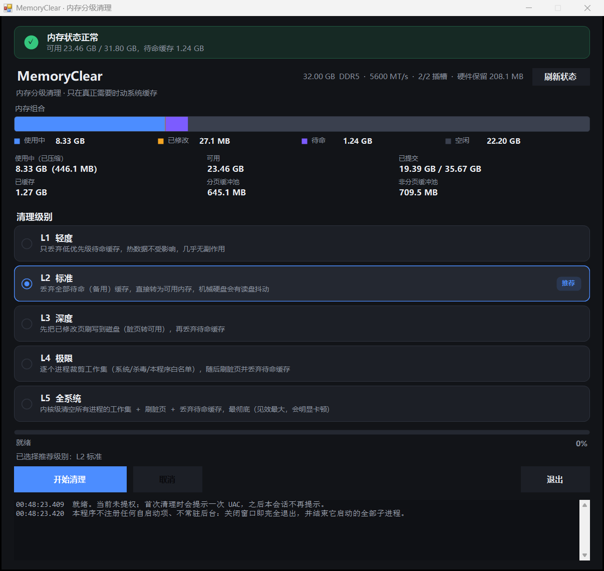

# MemoryClear

Windows 内存分级清理小工具：**单个 exe、无外部依赖、不常驻后台、不改系统设置**。



## 它做什么

按 5 个级别回收内存，全部基于 Windows 内核的内存列表接口（`NtSetSystemInformation` /
`SystemMemoryListInformation`）与 `SetProcessWorkingSetSizeEx`。不注入进程、不装驱动、
不写注册表、不注册服务或自启动项。

| 级别 | 操作 | 影响面 | 需要管理员 |
|---|---|---|---|
| L1 轻度 | 只丢弃低优先级待命缓存（cmd 5） | 热数据不受影响，几乎无副作用 | 是 |
| L2 标准 | 丢弃全部待命（备用）文件缓存（cmd 4） | 机械硬盘会有读盘抖动 | 是 |
| L3 深度 | 刷写已修改页（cmd 3）后丢弃待命缓存（cmd 4） | 一次写 IO 突发 | 是 |
| L4 极限 | 逐进程裁剪工作集 + 刷脏页 + 丢弃待命缓存 | 内置系统/杀毒/自身白名单；其它程序重新读盘 | 是 |
| L5 全系统 | 内核级清空所有进程工作集（cmd 2）→ 刷脏页 → 丢缓存 | 最彻底，整机短时卡顿 | 是 |

`cmd N` 指 `SYSTEM_MEMORY_LIST_COMMAND` 的取值。

## 关于“释放内存”的诚实说明

这个工具不会假装释放内存，日志会如实给出 **待命缓存 / 已修改 / 空闲** 的前后变化：

- **待命（备用）缓存本来就计入“可用内存”**。清掉它只是 standby → free，“可用内存”数字几乎不变。
  实测：待命 5.09 GB → 476 KB，可用内存 24.59 → 24.42 GB。
- **真正让“可用内存”数字上升的是清空工作集（L5）**，代价是各程序重新读盘。
  实测：可用内存 24.24 → 27.10 GB（+2.86 GB）。
- **裁剪工作集本身不释放内存**，它只是把页推进待命/已修改列表。所以 L4 在裁剪后必须再刷脏页、
  丢弃待命缓存，否则会出现“清理完缓存反而变大”的反直觉结果。
- **提交量（Commit）接近上限时，清缓存没有任何帮助**，应该排查占用内存的进程或增大页面文件。
  界面会直接提示这一点。

## 使用

双击 `MemoryClear.exe` → 选级别 → 开始清理。

- 首次清理会弹 **一次** UAC，程序拉起一个常驻本次会话的提权助手，之后复用，不再提示。
  若以管理员身份启动则完全不弹。
- 关闭窗口（标题栏 × 或「退出」按钮，两者等价）会**完全退出**，并结束它启动的提权子进程；
  即使主进程被强杀，助手也会因为父进程看门狗自行退出。
- 不注册自启动项、不常驻后台、不留配置文件。

## 界面

- **内存组合条**：使用中 / 已修改 / 待命 / 空闲 四段，清理时能直接看出哪一块被搬走。
- **数据网格**：使用中（已压缩）、可用、已提交、已缓存（待命+已修改）、分页缓冲池、非分页缓冲池。
- **硬件信息**：容量、类型、速率、插槽占用、为硬件保留的内存（WMI 读取）。
- **分级选择**：按当前内存压力推荐默认级别并说明理由，可手动改判。

## 构建

需要 Windows 10/11 与系统自带的 .NET Framework 4.x —— **不需要 Visual Studio，也不需要 .NET SDK**。

```bat
build.cmd
```

等价命令：

```bat
%WINDIR%\Microsoft.NET\Framework64\v4.0.30319\csc.exe /nologo /target:winexe /platform:anycpu /optimize+ ^
  /win32manifest:app.manifest /out:MemoryClear.exe ^
  /reference:System.dll /reference:System.Drawing.dll /reference:System.Windows.Forms.dll /reference:System.Management.dll ^
  MemoryClear.cs
```

源码为 C# 5 语法（兼容系统自带的旧编译器）。产物约 54 KB，单文件，拷到别的机器直接运行。

## 命令行

```bat
MemoryClear.exe --selftest            # 只读：内存快照、推荐级别、L4 预演
MemoryClear.exe --policy-test         # 只读：分级与告警判定表
MemoryClear.exe --cli --level 2       # 无界面执行（需管理员）
MemoryClear.exe --cli --level 4 --self-only   # 仅裁剪自身，用于安全自测
```

## 已知限制

- 仅支持 Windows（依赖 .NET Framework 与 NT API）。
- L1–L5 都需要管理员权限，由提权助手统一处理。
- L5 会让所有程序重新读盘，机械硬盘上卡顿明显，因此带二次确认且永不自动推荐。
- “可用内存”是系统级共享指标，两次采样之间的波动本身就有噪声，程序不做美化。

## 许可

MIT License，见 [LICENSE](LICENSE)。
